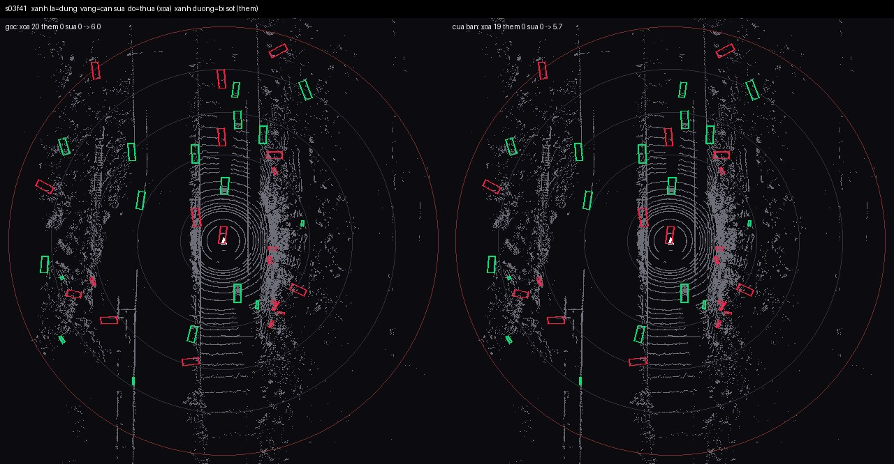

# Báo cáo Day 14 — Lê Tiến Bình — 2A202603346

- Mã học viên dùng với `--student`: `2A202603346`
- `seed_tag` trong `frames_A.txt`: `393590736f`

## 1. Dự đoán trước sweep (bước 5b)

Ghi **trước** khi chạy `scripts/pp_sweep.py`, rồi commit và push ngay (lịch sử commit là bằng chứng thời điểm viết). Không sửa phần này sau khi có kết quả.

- Tham số tôi nghĩ giảm công sửa nhiều nhất: **không tăng `score_thr`**, giữ ở mức thấp (`score_thr` = 0.1–0.2), `min_points` = 0–5. Tôi dự đoán tăng `score_thr` lên 0.3–0.5 sẽ làm công sửa **tăng** chứ không giảm; `min_points` gần như không ảnh hưởng.
- Vì sao (nhìn ảnh BEV tập A: box thừa nhiều hay box sót nhiều?):
  - Ở bước 5, cấu hình gốc phải xóa 37 hộp, chỉ thêm 2 hộp (chi phí 13.1). Tập A thừa hộp nhiều hơn sót, nên thoạt nhìn tăng `score_thr` để bớt rác có vẻ hợp lý.
  - Nhưng score của hộp rác và hộp đúng chồng lấn nhau: hộp rác (Car nằm trên bụi cây, Cyclist lơ lửng trên bồn cây ở hai dải phân cách trong ảnh BEV) phần lớn có score 0.3–0.55, trong khi nhiều hộp đúng cũng chỉ có score 0.13–0.47. Dưới 0.4 có 24 hộp rác nhưng cũng có 15 hộp đúng; dưới 0.3 có 5 hộp rác và 9 hộp đúng.
  - Mỗi hộp rác bị lọc chỉ tiết kiệm 0.3, còn mỗi hộp đúng bị lọc mất phải vẽ lại tốn 1.0. Ví dụ với `score_thr` = 0.4: tiết kiệm khoảng 24 × 0.3 = 7.2 nhưng tốn thêm khoảng 15 × 1.0 = 15, nên chi phí tăng.
  - Hộp rác nằm trên bụi cây và hàng rào nên có nhiều điểm LiDAR (chỉ 1/37 hộp bị xóa có dưới 10 điểm), vì vậy `min_points` không lọc được chúng.

## 2. Tập A: sửa tay và tune

| Cấu hình | Xóa | Thêm | Sửa | Chi phí |
|---|---:|---:|---:|---:|
| Gốc | 37 | 2 | 0 | 13.1 |
| `best_config.json` | 36 | 2 | 0 | 12.8 |

- Tham số đã đổi trong `best_config.json`: `min_points`: 0 → 10 (giữ `score_thr` = 0.1).
- Kết quả leave-one-out (dán các dòng `scripts/pp_sweep.py` in ra):

  ```text
  s02f32: cấu hình chọn {'score_thr': '0.1', 'min_points': '10'} → 3.9 (tốt nhất có thể 3.9)
  s03f41: cấu hình chọn {'score_thr': '0.1', 'min_points': '10'} → 5.7 (tốt nhất có thể 5.7)
  s04f17: cấu hình chọn {'score_thr': '0.1', 'min_points': '10'} → 3.2 (tốt nhất có thể 2.3)
  ```

- Cấu hình có ổn định trên từng frame không? Vì sao tôi vẫn chọn (hoặc không chọn) nó: Lựa chọn ổn định — cả 3 lần leave-one-out đều chọn cùng `score_thr` = 0.1, `min_points` = 10. Ở s02f32 và s03f41 cấu hình này đạt đúng mức tốt nhất có thể; ở s04f17 nó đạt 3.2 trong khi tốt nhất có thể là 2.3, nên không tối ưu cho mọi frame. Mức lợi rất nhỏ (12.8 so với 13.1, tức bớt đúng 1 hộp phải xóa), nằm trong mức dao động khi chỉ có 3 frame. Tôi vẫn chọn vì nó không làm mất hộp đúng nào (số hộp thêm vẫn là 2) và giữ `score_thr` thấp — điều mà toàn bộ sweep cho thấy là quan trọng nhất; thực chất nó gần như là cấu hình gốc.

## 3. Trước/sau (bước 8)



- `scripts/pp_compare.py` báo giảm 2% công sửa trên tập A (13.1 → 12.8; chỉ frame s03f41 thay đổi, 6.0 → 5.7).
- Dự đoán ở mục 1 đúng hay sai? Giải thích bằng số box xóa/thêm/sửa: **Phần chính đúng, phần phụ sai một chút.**
  - Đúng: tăng `score_thr` làm công sửa tăng chứ không giảm. Với `min_points` = 0: 0.1 → 13.1; 0.2 → 14.5; 0.3 → 20.6; 0.4 → 20.9; 0.5 → 27.1. Ở `score_thr` = 0.3, số xóa giảm 37 → 32 (bớt 5 hộp rác, −1.5) nhưng số thêm tăng 2 → 11 (mất 9 hộp đúng, +9.0) — khớp với đếm trước sweep (dưới 0.3 có 5 hộp rác và 9 hộp đúng). Ở 0.4 (`min_points` = 10) số xóa giảm còn 12 nhưng số thêm lên 17. Do xóa chỉ 0.3/hộp còn thêm 1.0/hộp, lọc theo score luôn lỗ trên tập A.
  - Sai một phần: tôi đoán `min_points` gần như không ảnh hưởng; thực tế `min_points` = 10 bớt được 1 hộp rác ít điểm ở s03f41 (xóa 37 → 36, chi phí 13.1 → 12.8) mà không làm mất hộp đúng nào. Ảnh so sánh s03f41 ở trên cho thấy thay đổi đó; các hộp rác còn lại trên bụi cây và hàng rào vẫn có nhiều điểm nên vẫn lọt, đúng như lý do ở mục 1.

## 4. Tập B

Số đo từ `scripts/pp_prelabel.py --frames d14_2A202603346/frames_B.txt --config d14_2A202603346/best_config.json --gt d14_2A202603346/ref_B.json`:

| Xóa | Thêm | Sửa | Chi phí |
|---:|---:|---:|---:|
| 90 | 9 | 7 | 39.5 |

- Loại box tốn công sửa nhất ở tập B: **hộp thừa trên thực vật và vật cố định** — Car/Cyclist/Pedestrian nằm trên bụi cây, bồn hoa, thân cây, hàng rào, tủ điện, biển quảng cáo, và hộp nằm trên chính xe thu dữ liệu (mỗi frame một hộp). 90 hộp xóa × 0.3 = 27, chiếm khoảng 68% chi phí 39.5; riêng s02f51 (đường ven công viên) có 25 hộp phải xóa, chi phí 8.0. Tiếp theo là hộp phải thêm (9 × 1.0 = 9): chủ yếu xe tải/xe buýt mà model KITTI không biết, người đi bộ và người đi xe máy bị sót. Hộp phải sửa (7 × 0.5 = 3.5) chủ yếu là sai lớp (người đi xe máy bị gán Car, xe tải/bán tải bị gán Car) và hộp lơ lửng/chìm so với mặt đường.

## 5. Giới hạn

- **Chỉ 3 frame để tune:** mức giảm 2% (bớt 1 hộp) quá nhỏ để khẳng định cấu hình tốt hơn cấu hình gốc; leave-one-out ở s04f17 đã cho thấy cấu hình chọn không tối ưu cho mọi frame.
- **Model học trên KITTI:** không có lớp Truck/Bus, hay sót người đi bộ và người đi xe hai bánh, chỉ nhìn 90° phía trước (phải chạy 4 lượt xoay). Lọc theo `score_thr`/`min_points` chỉ bỏ được hộp, không thêm được hộp bị sót; phần lớn rác nằm trên thực vật có nhiều điểm và score không thấp nên các tham số này không lọc được.
- **Chi phí là công thức** (0.3·xóa + 1.0·thêm + 0.5·sửa), không phải thời gian sửa thật; tôi không quy đổi ra giờ công.
- **Nhãn tham chiếu do tôi tự sửa** nên có thể còn sót vật ở xa hoặc thưa điểm; một số hộp tôi vẽ thêm có chiều dài/rộng chưa đặt đúng theo hướng xe.
- **Công cụ tự động ngoài pre-label của lab:** tôi dùng script do trợ lý AI viết để đánh dấu hộp nghi vấn (lơ lửng/chìm, nằm ngang đường, nằm trên xe thu dữ liệu) và dò cụm điểm chưa có hộp. Quyết định xóa/thêm/sửa cuối cùng do tôi kiểm và thực hiện trên CVAT.
